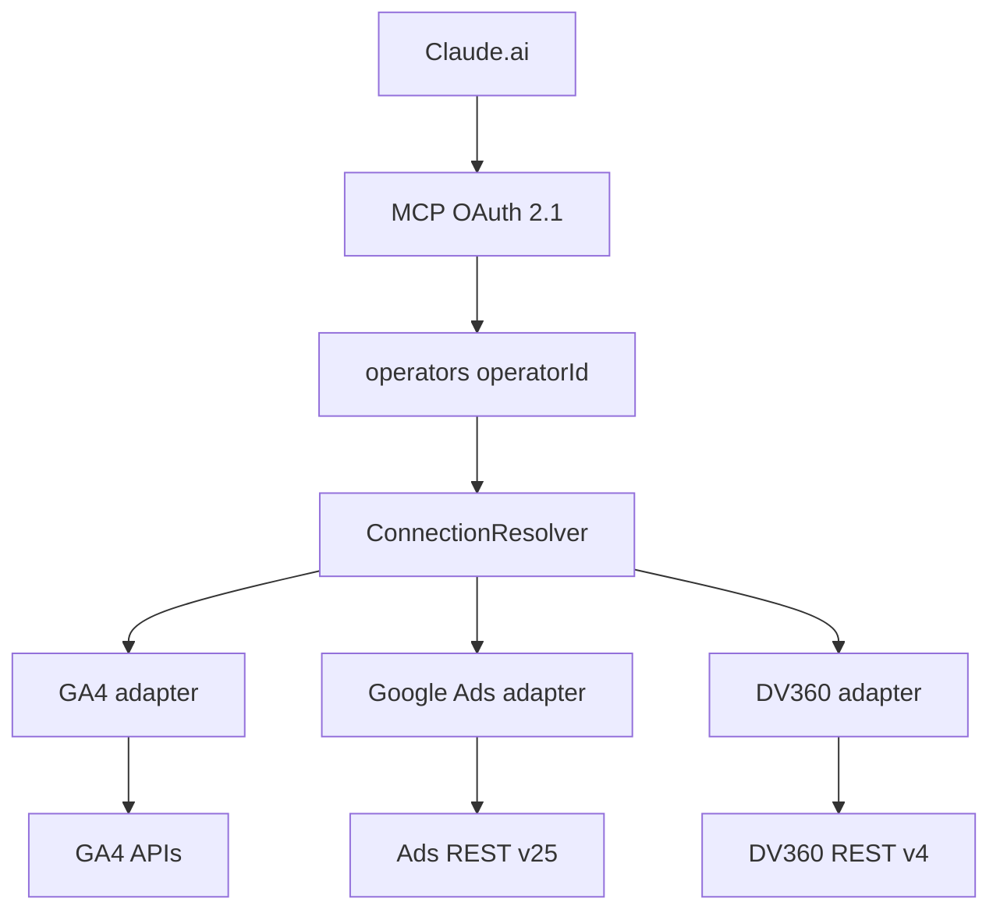

# gconnect-mcp-all-v1

True Model B Google Marketing MCP for Claude.ai Custom Connectors.

This is **not** a GA4-only connector and **not** a Google Ads-only connector. It is a shared platform with GA4, Google Ads, and Display & Video 360 adapters:

```text
Operator
  +-- Google Connection A
  |     +-- GA4 properties
  |     +-- Google Ads customers / MCC hierarchy
  |     +-- DV360 partners / advertisers
  +-- Google Connection B
```

MCP JWT `sub` is always the internal `operatorId`. Google OpenID `sub` lives only on `google_connections.googleSubjectId`.

## Architecture



See [docs/architecture.md](docs/architecture.md).

## Identity

- MCP authentication answers: who is the operator?
- Google OAuth answers: which Google account is connected?
- Uniqueness is `(operatorId, googleSubjectId)`, never email and never a global Google subject.

See [docs/identity-model.md](docs/identity-model.md).

## Persistence

Firestore **named database** `gconnect-mcp-all-v1` only.

Do not use `(default)` (V1) or `ga4-mcp-v3` (V3). Startup rejects those IDs.

See [docs/google-connections.md](docs/google-connections.md).

## Local development

1. Copy `.env.example` to `.env` and fill placeholders. Do not copy secrets from V3.
2. `npm install`
3. `npm test`
4. `npm run typecheck`
5. `npm run dev`

Claude Custom Connector URL is `http://localhost:3000/mcp`. Health is `GET /health`.

## Google Ads

Uses official Google Ads REST **v25**. Read-only. The app developer token is an application secret (`GOOGLE_ADS_DEVELOPER_TOKEN`), never a user OAuth credential.

The server resolves `login-customer-id` from discovered MCC hierarchy. Hyphenated customer IDs are normalized before API use.

See [docs/google-ads.md](docs/google-ads.md), [docs/ga4.md](docs/ga4.md), and [docs/dv360.md](docs/dv360.md).

## Display & Video 360

Uses official Display & Video 360 REST **v4**. Read-only discovery in this phase. Existing Google connections must reconnect to grant `https://www.googleapis.com/auth/display-video`. No extra secrets.

## Deployment

Cloud Run, unauthenticated ingress, named Firestore database `gconnect-mcp-all-v1`.

```powershell
.\scripts\cloud-run-setup.ps1 -ProjectId YOUR_PROJECT
.\scripts\cloud-run-deploy.ps1 -ProjectId YOUR_PROJECT
.\scripts\cloud-run-set-env.ps1 -ProjectId YOUR_PROJECT -AppBaseUrl https://... -GoogleClientId ... -GoogleClientSecret ... -McpTokenSecret ... -OauthStateSecret ... -TokenEncryptionKey ... -GoogleAdsDeveloperToken ...
```

See [docs/deployment.md](docs/deployment.md) and [docs/security.md](docs/security.md).
