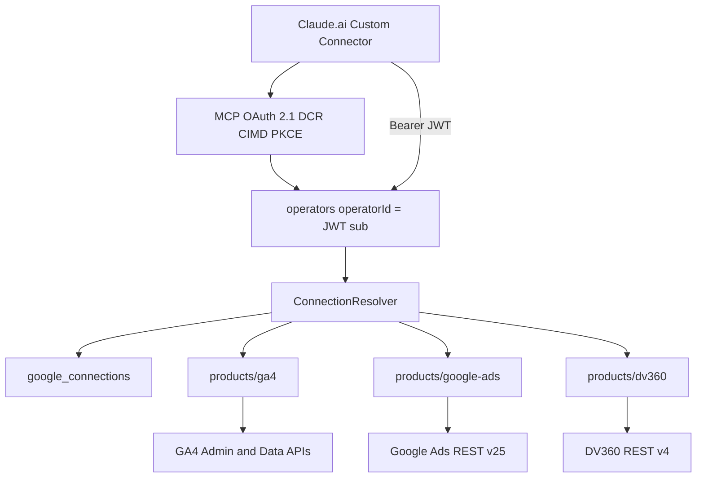

# Architecture

`gconnect-mcp-all-v1` is a Next.js 15 Cloud Run MCP server.

## Layers

- `src/mcp` — Claude Custom Connector surface, MCP OAuth, tool registration
- `src/providers/google` — shared Google OAuth, token refresh, connection ownership
- `src/core/resolver.ts` — product-aware resource resolution
- `src/products/ga4` — GA4 discovery, routing, Data/Admin API
- `src/products/google-ads` — Ads REST client, hierarchy, routing, GAQL
- `src/products/dv360` — Display & Video 360 REST v4 client, partner/advertiser discovery, routing
- `src/store` — Firestore + in-memory `AppStore`

DV360 reporting (Bid Manager / spend) is not implemented. Discovery tools reuse operator identity, Google connections, OAuth, encryption, resolver, MCP auth, and logging.
